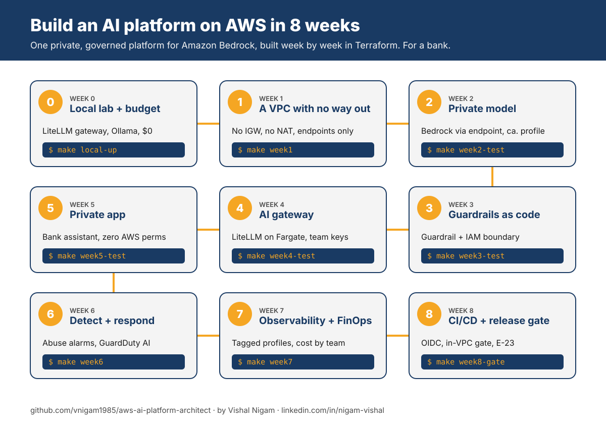

# AWS AI Platform Architect Roadmap 2026

> A step-by-step guide and an 8-week build-along course for becoming a **Cloud AI Platform Architect on AWS**: private networking, IAM guardrails, an AI gateway, security, FinOps and CI/CD for Amazon Bedrock, with working Terraform.

<p align="left">
  <a href="https://www.linkedin.com/in/nigam-vishal/"></a>
  <a href="https://www.youtube.com/@thrivewithvishal"></a>
  <a href="https://www.instagram.com/thrivewithvishal"></a>
  <a href="https://vnigam1985.github.io"></a>
  <a href="https://mentoraccelerate.com/90-day-job-search-framework"></a>
</p>

Most AI roadmaps teach you to build a chatbot. This one teaches you to build the **platform** every chatbot, agent and RAG app in a large company runs on: private networking, IAM, guardrails, an AI gateway, observability and cost control. That's the part enterprises struggle with, and the part they pay architects for.

It's written for cloud, platform, network, security and DevOps engineers who already know AWS infrastructure and want to move into AI. If you know VPCs, endpoints, IAM and Organizations, you already have half of this job.

There are two ways to use it:

1. **The 8-week build-along course.** Build one private, governed AI platform on AWS in Terraform, a layer a week, and run a real workload on it.
2. **The roadmap.** Twelve steps of what to learn, with free and paid resources, certifications and interview prep.

## ⭐ Give a Star

If this helps you learn or plan your career, please give it a star. It helps other engineers find it.

## ⚠️ Disclaimer

AWS AI moves fast. Bedrock model availability by Region changes every month, AgentCore went GA in October 2025 and keeps adding features, GuardDuty AI Protection arrived in July 2026, and the ML Specialty exam was retired in March 2026. Facts and links here were checked in **October 2026** (see [VERIFICATION.md](VERIFICATION.md)). If something looks out of date, open an issue.

This roadmap shows the landscape. You don't need every tool on it. Learn the fundamentals deeply, then pick what your organization actually uses.

---

## Table of Contents

- [🚀 The 8-week build-along course](#-the-8-week-build-along-course)
- [The role in one picture](#the-role-in-one-picture)
- [Learning path (mostly free)](#learning-path-mostly-free)
  1. [GenAI fundamentals for infrastructure people](#1-genai-fundamentals-for-infrastructure-people)
  2. [Amazon Bedrock](#2-amazon-bedrock)
  3. [The app plane](#3-the-app-plane)
  4. [Private networking for AI](#4-private-networking-for-ai)
  5. [The AI gateway](#5-the-ai-gateway)
  6. [Governance: Organizations, SCPs and IAM for AI](#6-governance-organizations-scps-and-iam-for-ai)
  7. [Security for AI and agents](#7-security-for-ai-and-agents)
  8. [RAG and agent building blocks](#8-rag-and-agent-building-blocks)
  9. [Infrastructure as Code and landing zones](#9-infrastructure-as-code-and-landing-zones)
  10. [Observability and FinOps](#10-observability-and-finops)
  11. [Regulated industries (banking and OSFI)](#11-regulated-industries)
  12. [AI-assisted platform engineering](#12-ai-assisted-platform-engineering)
- [Certifications](#certifications)
- [Interview preparation](#interview-preparation)
- [Repository map](#repository-map)
- [About the author](#-about-the-author)

---

## 🚀 The 8-week build-along course



| Week | Topic | You build | Command | Branch |
| --- | --- | --- | --- | --- |
| 0 | [Setup and local lab](weeks/00-setup-and-local-lab/README.md) | The whole request path on your laptop for $0 (LiteLLM gateway + Ollama), then a budget | `make local-up` | `week-00` |
| 1 | [A VPC with no way out](weeks/01-private-vpc/README.md) | Private subnets, no IGW, no NAT, S3 endpoint, flow logs | `make week1` | `week-01` |
| 2 | [Private model](weeks/02-private-model/README.md) | Bedrock through a VPC endpoint, Canada-only `ca.` profile, endpoint-scoped IAM, proven from inside and outside | `make week2-test` | `week-02` |
| 3 | [Guardrails as code](weeks/03-guardrails-as-code/README.md) | Bedrock Guardrail, invocation logging, a permissions boundary tested with an over-permissioned role | `make week3-test` | `week-03` |
| 4 | [AI gateway](weeks/04-ai-gateway/README.md) | LiteLLM on ECS Fargate behind an internal ALB, team keys with token limits, Aurora that scales to zero | `make week4-test` | `week-04` |
| 5 | [Private app](weeks/05-private-app/README.md) | The bank assistant on ECS with zero AWS permissions, model only through the gateway | `make week5-test` | `week-05` |
| 6 | [Detect and respond](weeks/06-detect-and-respond/README.md) | Gateway abuse alarms, control-tampering alerts, GuardDuty AI Protection | `make week6` | `week-06` |
| 7 | [Observability and FinOps](weeks/07-observability-finops/README.md) | Tagged application inference profiles, dashboard, token alarm, team budget | `make week7` | `week-07` |
| 8 | [CI/CD and release gate](weeks/08-cicd-release-gate/README.md) | GitHub OIDC, in-VPC golden-question gate with rollback, OSFI E-23 model inventory | `make week8-gate` | `week-08` |

**Quickstart:** `make local-up && make local-keys && make local-test` (free), then `make week0 EMAIL=you@example.com`.

**Cost:** week 0 is $0. The AWS weeks cost roughly **$20 to $40** if you do weeks 4 to 8 within two weeks, pause between sessions, and then `make destroy`. Details: [COSTS.md](COSTS.md). Use your own account, never your employer's.

**Want to test the AI instead of hosting it?** The companion course [ai-quality-engineer](https://github.com/vnigam1985/ai-quality-engineer) uses the same bank assistant.

---

## The role in one picture

An AI Platform Architect owns four planes. Most engineers come in strong on one or two.

| Plane | What it covers on AWS | Typical starting point |
| --- | --- | --- |
| **Network plane** | VPC design, interface endpoints, Route 53 private hosted zones, Transit Gateway or Cloud WAN, egress control | Network and platform engineers |
| **Governance plane** | Organizations and OUs, SCPs, permissions boundaries, Control Tower or Landing Zone Accelerator, approved models, data residency | Cloud governance and security engineers |
| **AI service plane** | Bedrock models and inference profiles, Guardrails, Knowledge Bases, AgentCore | Data and AI engineers |
| **App and gateway plane** | ECS, EKS, Lambda, ALB, API Gateway, the AI gateway | App and DevOps engineers |

---

## Learning path (mostly free)

Resource tags: **FREE**, **PAID**, **Udemy**, **Docs**, **Repo**, **Blog**.

### 1. GenAI fundamentals for infrastructure people

You don't need to train models. You do need to speak the language well enough to design for it.

Here you need to learn:
- What a token is, and why every quota, limit and bill is measured in tokens
- How RAG works: chunking, embeddings, vector search, grounding
- What an agent does differently from a chatbot (it calls tools and takes actions)
- What MCP (Model Context Protocol) is, and why companies now need to govern MCP servers

Resources:
- [AWS Certified AI Practitioner (AIF-C01)](https://aws.amazon.com/certification/certified-ai-practitioner/) exam guide and free AWS Skill Builder prep (**FREE** to study, exam **PAID**)
- [What is Amazon Bedrock?](https://docs.aws.amazon.com/bedrock/latest/userguide/what-is-bedrock.html) (**FREE**, Docs)

### 2. Amazon Bedrock

Bedrock is where models, guardrails, knowledge bases and agents live. Learn its access and routing model first, because networking, IAM and residency all hang off it.

Here you need to learn:
- **Model access.** Access is on by default with the right Marketplace permissions; Anthropic models still need a one-time use-case form per account
- **Cross-Region inference.** `ca.`, `us.` and `global.` profiles decide where prompts are processed. From ca-central-1, many models are only available through a profile. For a Canadian bank this is a compliance decision
- **Application inference profiles** for cost allocation by tag
- **Converse API** as the one interface for every model
- **Provisioned throughput** vs on-demand

Resources:
- [Supported models by Region](https://docs.aws.amazon.com/bedrock/latest/userguide/models-region-compatibility.html) (**FREE**, Docs). Bookmark it
- [Accelerate generative AI innovation in Canada with Amazon Bedrock cross-Region inference](https://aws.amazon.com/blogs/machine-learning/accelerate-generative-ai-innovation-in-canada-with-amazon-bedrock-cross-region-inference) (**FREE**, Blog)
- [Securing Amazon Bedrock cross-Region inference: geographic and global](https://aws.amazon.com/blogs/machine-learning/securing-amazon-bedrock-cross-region-inference-geographic-and-global/) (**FREE**, Blog)
- Course: [week 2](weeks/02-private-model/README.md)

### 3. The app plane

Many platform engineers have never deployed the apps that sit in front of AI. You don't need to write them, but you must design their networking and identity.

Here you need to learn:
- ECS on Fargate, EKS and Lambda in private subnets
- Internal and internet-facing ALBs, AWS WAF in front of AI apps
- Task roles, execution roles and secrets injection
- Exactly which VPC endpoints each service needs when there's no NAT

Resources:
- [Securing Amazon Bedrock AgentCore Runtime with AWS WAF](https://aws.amazon.com/blogs/machine-learning/securing-amazon-bedrock-agentcore-runtime-with-aws-waf/) (**FREE**, Blog)
- Course: [week 5](weeks/05-private-app/README.md)

### 4. Private networking for AI

This is where network engineers win. Every enterprise AI design is mostly a networking and IAM document with a model endpoint attached.

Here you need to learn:
- **Interface endpoints** for `bedrock-runtime`, `bedrock`, `bedrock-agent-runtime`, and for AgentCore (`bedrock-agentcore`, `bedrock-agentcore-control`, `bedrock-agentcore.gateway`)
- **`aws:SourceVpce` and endpoint policies**: identity that only works on the right network path
- **Centralized endpoints**: endpoints in a shared VPC, private DNS off, Route 53 private hosted zones shared with spokes
- **Regional STS** in no-egress VPCs
- What "private" means for a regional AWS service with a public endpoint

Resources:
- [Use Amazon Bedrock with interface VPC endpoints](https://docs.aws.amazon.com/bedrock/latest/userguide/vpc-interface-endpoints.html) (**FREE**, Docs)
- [AWS services that integrate with AWS PrivateLink](https://docs.aws.amazon.com/vpc/latest/privatelink/aws-services-privatelink-support.html) (**FREE**, Docs)
- Course: [weeks 1 and 2](weeks/01-private-vpc/README.md)

### 5. The AI gateway

Every serious enterprise puts a gateway between apps and models: per-team keys and token budgets, chargeback, model routing and failover, central guardrails.

Here you need to learn:
- Why **API Gateway usage plans** aren't enough (they count requests, not tokens)
- The AWS **multi-provider generative AI gateway** guidance (LiteLLM on ECS or EKS)
- **AgentCore Gateway** for governing which tools (MCP) agents may call
- Rate limits, budgets, fallbacks and spend tracking per team

Resources:
- [Guidance for Multi-Provider Generative AI Gateway on AWS](https://aws-solutions-library-samples.github.io/ai-ml/guidance-for-multi-provider-generative-ai-gateway-on-aws.html) (**FREE**, Docs) and its [repo](https://github.com/aws-solutions-library-samples/guidance-for-multi-provider-generative-ai-gateway-on-aws)
- [Streamline AI operations with the Multi-Provider Generative AI Gateway reference architecture](https://aws.amazon.com/blogs/machine-learning/streamline-ai-operations-with-the-multi-provider-generative-ai-gateway-reference-architecture) (**FREE**, Blog)
- [Govern AI agent tool access with Amazon Bedrock AgentCore Gateway](https://aws.amazon.com/blogs/machine-learning/govern-ai-agent-tool-access-with-amazon-bedrock-agentcore-gateway/) (**FREE**, Blog)
- [LiteLLM proxy docs](https://docs.litellm.ai/docs/simple_proxy) (**FREE**, Docs)
- Course: [week 4](weeks/04-ai-gateway/README.md)

### 6. Governance: Organizations, SCPs and IAM for AI

Here you need to learn:
- **SCPs** for data residency using `aws:RequestedRegion` and `bedrock:InferenceProfileArn`, including how global profiles evaluate as `unspecified`
- **`bedrock:GuardrailIdentifier`** to require a guardrail on every model call
- **Permissions boundaries** for delegated role creation
- Protecting invocation logging and guardrails from being turned off
- Enforcing usage through tagged application inference profiles

Resources:
- [Access OpenAI GPT models on Amazon Bedrock from Canada with cross-Region inference](https://aws.amazon.com/blogs/machine-learning/access-openai-gpt-models-on-amazon-bedrock-from-canada-with-cross-region-inference/) (**FREE**, Blog). Has the Canada SCP
- [Enforce a guardrail with IAM](https://docs.aws.amazon.com/bedrock/latest/userguide/guardrails-permissions-id.html) (**FREE**, Docs)
- [Enforce Amazon Bedrock usage through tagged application inference profiles using SCPs](https://repost.aws/articles/ARNs8E22zOSISXtHagFidfig/enforce-amazon-bedrock-usage-through-tagged-application-inference-profiles-using-scps) (**FREE**, community article; test before using)
- In this repo: [governance/](governance/README.md). Course: [week 3](weeks/03-guardrails-as-code/README.md)

### 7. Security for AI and agents

Here you need to learn:
- **Bedrock Guardrails**: content filters, prompt-attack detection, PII masking, denied topics, contextual grounding
- **GuardDuty AI Protection** (GA July 2026): anomalous model invocation, cost harvesting, prompt injection, logging tampering findings
- **Security Hub** AI security best practices controls and AI inventory
- Threat models: OWASP Top 10 for LLM Applications and for Agentic Applications

Resources:
- [GuardDuty AI Protection](https://docs.aws.amazon.com/guardduty/latest/ug/ai-protection.html) (**FREE**, Docs)
- [Amazon Bedrock Guardrails](https://docs.aws.amazon.com/bedrock/latest/userguide/guardrails.html) (**FREE**, Docs)
- [OWASP GenAI LLM Top 10 2026](https://genai.owasp.org/home/resources/owasp-genai-llm-top-10-2026/) and [OWASP Top 10 for Agentic Applications](https://genai.owasp.org/resource/owasp-top-10-for-agentic-applications/) (**FREE**)
- Course: [week 6](weeks/06-detect-and-respond/README.md)

### 8. RAG and agent building blocks

You won't write the agents, but you'll be asked which hosting, memory, identity and tool choices the platform supports.

Here you need to learn:
- **Knowledge Bases for Amazon Bedrock** and vector store options
- **Amazon Bedrock AgentCore**: Runtime, Memory, Gateway, Identity, Code Interpreter, Browser, Observability, Policy
- Which AgentCore features are available in your Region (some are US and EU only)
- **MCP on AWS**: the official AWS MCP servers

Resources:
- [Amazon Bedrock AgentCore starter toolkit](https://aws.github.io/bedrock-agentcore-starter-toolkit/) (**FREE**, Docs)
- [awslabs/mcp](https://github.com/awslabs/mcp) (**FREE**, Repo)
- [awslabs/generative-ai-cdk-constructs](https://github.com/awslabs/generative-ai-cdk-constructs) (**FREE**, Repo)

### 9. Infrastructure as Code and landing zones

Here you need to learn:
- Multi-account structure with **Control Tower** or **Landing Zone Accelerator**
- Terraform's AWS provider: Bedrock, Guardrails, inference profiles and AgentCore resources are all available in provider 6.x
- Remote state, plan reviews, and GitHub Actions with **OIDC** (no access keys)

Resources:
- [awslabs/landing-zone-accelerator-on-aws](https://github.com/awslabs/landing-zone-accelerator-on-aws) (**FREE**, Repo)
- [Terraform AWS provider docs](https://registry.terraform.io/providers/hashicorp/aws/latest/docs) (**FREE**, Docs)
- Course: every week is Terraform; [week 8](weeks/08-cicd-release-gate/README.md) adds the pipeline

### 10. Observability and FinOps

Here you need to learn:
- **CloudWatch** `AWS/Bedrock` metrics: `InputTokenCount`, `OutputTokenCount`, `InvocationThrottles`, `InvocationLatency`, `EstimatedTPMQuotaUsage`
- **Model invocation logging** for audit
- **Cost allocation** with tagged application inference profiles, Cost Explorer and the Cost and Usage Report (CUR 2.0)
- On-demand vs provisioned throughput

Resources:
- [Bedrock runtime metrics](https://docs.aws.amazon.com/bedrock/latest/userguide/monitoring-runtime-metrics.html) (**FREE**, Docs)
- Course: [week 7](weeks/07-observability-finops/README.md)

### 11. Regulated industries

Banks, insurers and governments are the biggest buyers of AI platform architects, and the most demanding. In Canada, the key regulator for banks is OSFI.

Here you need to learn:
- **OSFI Guideline E-23 (Model Risk Management)**, in force **May 1, 2027**. AI and ML models are in scope: inventory, risk rating, validation, monitoring, including third-party foundation models
- **OSFI Guideline B-13** (Technology and Cyber Risk Management)
- Where prompts are processed (`ca.` vs `us.` vs `global.`) and how you prove it
- How your platform produces the evidence auditors ask for

Resources:
- [OSFI Guideline E-23: Model Risk Management (2027)](https://www.osfi-bsif.gc.ca/en/guidance/guidance-library/guideline-e-23-model-risk-management-2027) (**FREE**)
- [OSFI Guideline B-13: Technology and Cyber Risk Management](https://www.osfi-bsif.gc.ca/en/guidance/guidance-library/technology-cyber-risk-management) (**FREE**)
- Course: the [model inventory](governance/model-inventory/model_inventory.yaml) in [week 8](weeks/08-cicd-release-gate/README.md)

### 12. AI-assisted platform engineering

The best defence against being replaced by AI is being the engineer who gets 3x more done with it. Use coding agents to draft Terraform, IAM policies and runbooks, and stay the reviewer.

Here you need to learn:
- Drafting IaC and IAM with an AI coding assistant, then validating with `terraform validate`, `plan` and IAM Access Analyzer policy checks
- Giving the agent your standards: naming, tagging, approved modules, boundary rules
- Reviewing AI output like a pull request: never trust it, always test it

Resources:
- [awslabs/mcp](https://github.com/awslabs/mcp): MCP servers that let AI assistants work with AWS docs and services (**FREE**, Repo)

---

## Certifications

| Certification | Exam | Why it matters | Priority |
| --- | --- | --- | --- |
| [AWS Certified AI Practitioner](https://aws.amazon.com/certification/certified-ai-practitioner/) | AIF-C01 | Vocabulary warm-up | Optional |
| [AWS Certified Generative AI Developer - Professional](https://aws.amazon.com/certification/certified-generative-ai-developer-professional/) | AIP-C01 | Bedrock, RAG, agents, guardrails at professional depth | **High** |
| [AWS Certified Solutions Architect - Professional](https://aws.amazon.com/certification/certified-solutions-architect-professional/) | SAP-C02 | The architect credential hiring managers look for | **High** |
| [AWS Certified Security - Specialty](https://aws.amazon.com/certification/certified-security-specialty/) | SCS-C03 | Updated with GenAI security coverage | High |
| [AWS Certified Advanced Networking - Specialty](https://aws.amazon.com/certification/certified-advanced-networking-specialty/) | ANS-C01 | The networking half of the job | Medium |
| [AWS Certified Machine Learning Engineer - Associate](https://aws.amazon.com/certification/certified-machine-learning-engineer-associate/) | MLA-C01 | If you'll also support ML platforms | Optional |

The Machine Learning Specialty was retired on March 31, 2026.

Paid prep:
- [Ultimate AWS Certified Generative AI Developer Professional](https://www.udemy.com/course/ultimate-aws-certified-generative-ai-developer-professional/) by Frank Kane and Stephane Maarek (**Udemy**). Check the current rating before buying

---

## Interview preparation

Practise answering these out loud, with diagrams:

1. Design a private, multi-account GenAI platform for 40 internal teams at a Canadian bank. How do you enforce data residency, per-team token budgets and chargeback?
2. A team wants Claude, but it's only reachable from ca-central-1 through a cross-Region profile. Walk through the options (`ca.`, `us.`, `global.`), the risk of each, and the SCP you'd write.
3. How do you prove that an app can only reach Bedrock through a VPC endpoint? What does `aws:SourceVpce` give you, and what doesn't it?
4. API Gateway, AgentCore Gateway or a LiteLLM gateway: which problem does each solve?
5. How do you make sure no team can call a model without a guardrail, or turn off invocation logging?
6. An agent in AgentCore Runtime needs to call internal APIs. Design its identity, network path and tool governance.
7. Leadership asks "what are we spending on AI, by team, and is it worth it?" What do you build?
8. What does OSFI E-23 require for a third-party foundation model, and what evidence does your platform produce?

The course weeks each end with a resume bullet and an "interview angle". Use them.

---

## Repository map

```
aws-ai-platform-architect/
├── README.md                 ← you are here
├── weeks/                    the 8-week course, one folder per week
├── infra/                    Terraform, one root per week (local state), plus the prober Lambda
├── app/                      the bank assistant workload (same app as ai-quality-engineer)
├── local/                    week 0 local lab: LiteLLM gateway config and tests
├── governance/               model inventory (E-23), SCP version of the week 3 guardrails
├── scripts/ + evals/         tests, release gate, inventory checks
├── Makefile                  every command: make help
├── COSTS.md                  what it costs and how to keep it low
└── VERIFICATION.md           what was tested and what wasn't
```

Every Terraform root is checked with `terraform fmt` and `terraform validate` on every push by [.github/workflows/validate.yml](.github/workflows/validate.yml).

## Contribution

Found an outdated link, a better resource, or a bug in the course? Open an issue or a pull request. See [CONTRIBUTING.md](CONTRIBUTING.md).

## License

[MIT](LICENSE)

---

## 👋 About the author

**Vishal Nigam** is a Senior Cloud Engineer and Azure SME with 18+ years in enterprise IT. He builds cloud platforms, landing zones, network security and guardrails for large regulated companies, and now helps engineers move into AI platform work.

He came to Canada in 2017 with $5,000, a wife, a 4-year-old son and zero connections. He has since landed 6 job offers in Canada without a single direct application. No one handed him a playbook, so he built one, and he shares it for free.

He teaches systems, strategy and execution. Not motivation.

### Follow for more

| Where | What you get |
| --- | --- |
| [LinkedIn](https://www.linkedin.com/in/nigam-vishal/) | Azure platform engineering, cloud careers and job search, posted several times a week |
| [YouTube](https://www.youtube.com/@thrivewithvishal) | Long-form videos on cloud careers and platform engineering |
| [Instagram @thrivewithvishal](https://www.instagram.com/thrivewithvishal) | Cloud career tips and the personal journey |
| [Instagram @mentoraccelerate](https://www.instagram.com/mentoraccelerate) | Cloud, DevOps, job search and interview tips |
| [Instagram @cloudwithvishal](https://www.instagram.com/cloudwithvishal) | Cloud Episodes in Hindi, cloud interview reels |
| [Instagram @cloudwithvishal.en](https://www.instagram.com/cloudwithvishal.en) | Cloud Episodes in English |
| [X](https://x.com/thrivewidvishal) | Quick takes on cloud and AI |
| [Facebook](https://www.facebook.com/people/Vishal-Nigam/61565195962651/) | Updates and videos |
| [Portfolio](https://vnigam1985.github.io) | Projects and experience |
| [GitHub](https://github.com/vnigam1985) | More free roadmaps and templates |
| [All links](https://linktr.ee/nigamv) | Everything in one place |

### Free resources

- 📘 **[90-Day Job Search Framework](https://mentoraccelerate.com/90-day-job-search-framework)**: the step-by-step system for landing a cloud role, free
- 🤝 **[MentorAccelerate Cloud Career Community waitlist](https://mentoraccelerate.com/cloudcareercommunitywaitlist)**: a place to prepare for cloud roles and get help from working cloud engineers

### More free roadmaps by Vishal

| Repo | For |
| --- | --- |
| [azure-ai-platform-architect](https://github.com/vnigam1985/azure-ai-platform-architect) | Becoming an AI Platform Architect on Microsoft Azure |
| [aws-ai-platform-architect](https://github.com/vnigam1985/aws-ai-platform-architect) | Becoming an AI Platform Architect on AWS |
| [gcp-ai-platform-architect](https://github.com/vnigam1985/gcp-ai-platform-architect) | Becoming an AI Platform Architect on Google Cloud |
| [ai-quality-engineer](https://github.com/vnigam1985/ai-quality-engineer) | QA and test engineers moving into AI and LLM testing |

If this repo helped you, **star it**, and tell Vishal on LinkedIn what you built with it.
