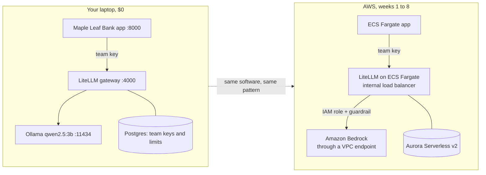

# Week 0: Set up, and build the whole platform on your laptop first ($0)

**Goal:** see the shape of an enterprise AI platform before you spend a cent on AWS. You run the same three layers locally: the app, an AI gateway, and a model.



On AWS you'll run **the same gateway software** (LiteLLM) that you run here. That's on purpose: AWS doesn't have a managed "token budget per team" gateway for Bedrock, and AWS's own reference answer is the [Guidance for Multi-Provider Generative AI Gateway on AWS](https://github.com/aws-solutions-library-samples/guidance-for-multi-provider-generative-ai-gateway-on-aws), which is LiteLLM on ECS or EKS. What you learn this week carries straight over.

## Part A: tools (30 minutes)

| Tool | Why | Install |
| --- | --- | --- |
| Docker Desktop | Local lab, and building images in weeks 4 and 5 | [docker.com](https://www.docker.com/products/docker-desktop/) |
| AWS CLI v2 | Every AWS step | [Install the AWS CLI](https://docs.aws.amazon.com/cli/latest/userguide/getting-started-install.html) |
| Terraform 1.9+ | All the infrastructure | [Install Terraform](https://developer.hashicorp.com/terraform/install) |
| make, git, Python 3.11+, openssl | Commands and scripts | Your OS package manager |
| An AWS account you own | Weeks 1 to 8 | A personal account. **Not your employer's.** |

Sign in with an admin user or SSO profile (`aws configure sso` or `aws configure`). Never create long-lived access keys for the root user.

## Part B: the local lab (1 hour)

```bash
git clone https://github.com/vnigam1985/aws-ai-platform-architect.git
cd aws-ai-platform-architect
make local-up      # app, gateway, Postgres, Ollama; pulls a 2 GB model the first time
make local-keys    # creates the app's team key: 20 requests/min, 20,000 tokens/min
make local-test    # 6 checks
```

Expected:

```
PASS  no key is refused (401)
PASS  wrong key is refused (401)
PASS  team key works (200)
PASS  team key can't use other models (403)
PASS  3rd call in a minute is throttled (429)
PASS  app answers through the gateway
6 passed, 0 failed
```

Open http://localhost:8000 and ask "How much is an international wire transfer?"

### Read the config

Open [local/litellm-config.yaml](../../local/litellm-config.yaml):

- Apps ask for `bank-chat`. The gateway decides what serves it. On AWS, `bank-chat` will point at a Bedrock model, and apps won't change at all.
- There's an admin key (only you) and team keys (one per app, with their own limits). Apps never get the admin key.
- `fallbacks` sends traffic to a `mock` model if Ollama is down. Run `docker compose stop ollama`, ask the app a question, and watch the failover.

## Part C: AWS guardrails before anything else (15 minutes)

```bash
make check                          # read it carefully: right account?
make week0 EMAIL=you@example.com    # a monthly budget with email alerts
```

You get emails at 50% and 90% of actual spend, and when the forecast passes 100%. A budget never stops spending. **`make destroy` stops spending.**

Region is **ca-central-1** (Canada Central). Week 2 explains which Bedrock models run inside Canada and which only reach Canada through cross-Region inference.

Terraform state for each week is stored next to the code in `infra/weekNN/terraform.tfstate`. It's simple for a lab. In a company you'd use an S3 backend with locking.

## Check your work

- [ ] `make local-test` shows 6 passed
- [ ] You watched a fallback happen with Ollama stopped
- [ ] `make check` shows your own account, and you can see the budget in the Billing console

## Go deeper

- [LiteLLM proxy config](https://docs.litellm.ai/docs/proxy/configs)
- [Guidance for Multi-Provider Generative AI Gateway on AWS](https://aws-solutions-library-samples.github.io/ai-ml/guidance-for-multi-provider-generative-ai-gateway-on-aws.html)
