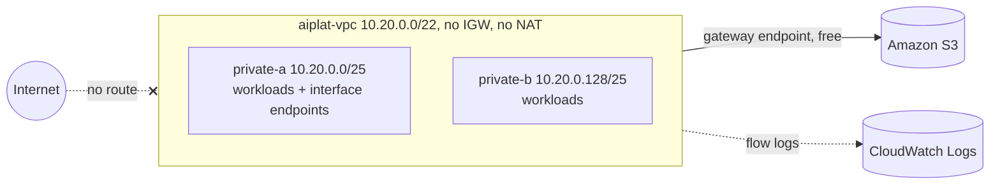

# Week 1: A VPC with no way out

**Goal:** the network every later week plugs into. It has **no internet gateway and no NAT gateway**. Anything a workload needs from AWS arrives through a VPC endpoint. That's the posture banks expect for AI workloads, and it forces you to learn exactly which endpoints each service needs.



## Deploy (2 minutes)

```bash
make week1
```

## What you built, and why

| Resource | Why an AI platform needs it |
| --- | --- |
| Two private subnets in two AZs | The internal load balancer in week 4 needs two AZs |
| No `0.0.0.0/0` route | Nothing can call out to the internet, so nothing can leak to it |
| S3 gateway endpoint (free) | Container image layers from ECR are stored in S3 |
| Endpoint security group | Interface endpoints accept HTTPS from inside the VPC only |
| Workload security group | Lambda and ECS tasks. Outbound stays inside the VPC |
| Flow logs | Evidence that traffic stays where you say it does |

Interface endpoints cost about USD 7.30 per AZ per month each (October 2026), so this course adds each one in the week that needs it, in **one** AZ:

| Week | Endpoints added | Used by |
| --- | --- | --- |
| 2 | `bedrock-runtime` | Calling models |
| 4 | `ecr.api`, `ecr.dkr`, `logs`, `secretsmanager` | ECS pulling images, writing logs, reading secrets |

## Check your work

```bash
aws ec2 describe-route-tables --filters Name=tag:Name,Values=aiplat-private --query "RouteTables[0].Routes"
aws ec2 describe-internet-gateways --filters Name=attachment.vpc-id,Values=$(cd infra/week01-landing-zone && terraform output -raw vpc_id)
```

- [ ] The route table has only the local route and the S3 prefix list
- [ ] No internet gateway is attached
- [ ] You can explain why a Lambda in this VPC can't download a Python package from PyPI

## Production differences (say these in interviews)

- **Centralized endpoints.** Large companies put interface endpoints in a shared "endpoints" VPC, turn off their private DNS, and share Route 53 private hosted zones with every spoke VPC through Transit Gateway or Cloud WAN. One set of endpoints instead of one per VPC.
- **Regional STS.** A no-egress VPC that needs STS must use the regional STS endpoint, not the global one.
- **Two or three AZs for every endpoint**, not one.
- **Landing Zone Accelerator** or Control Tower to build the account structure, not hand-written Terraform.

## Cost

S3 gateway endpoints are free. Flow logs to CloudWatch cost a little per GB ingested; retention is 7 days.

## Resume bullet

> Designed an egress-free VPC for AI workloads in Terraform: private subnets only, VPC endpoints added per service, flow logs for evidence, and security groups that keep all traffic inside the VPC.

## Go deeper

- [AWS PrivateLink concepts](https://docs.aws.amazon.com/vpc/latest/privatelink/concepts.html)
- [Use Amazon Bedrock with interface VPC endpoints](https://docs.aws.amazon.com/bedrock/latest/userguide/vpc-interface-endpoints.html)
