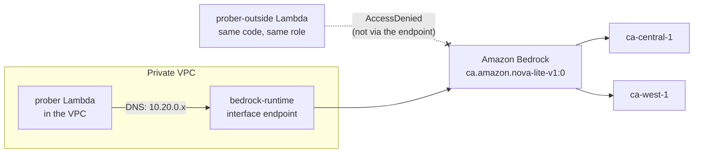

# Week 2: A private path to Bedrock, and proof that it's private

**Goal:** call an approved model from inside the egress-free VPC, keep processing inside Canada, and prove that the same credentials are refused on any other network path.



## Choosing a model for a Canadian bank

From ca-central-1, many Bedrock models only run through **cross-Region inference profiles** (CRIS). The profile prefix decides where your prompts are processed:

| Prefix | Processed in | Example from ca-central-1 (checked October 2026) |
| --- | --- | --- |
| `ca.` | ca-central-1 and ca-west-1 only | `ca.amazon.nova-lite-v1:0`, `ca.anthropic.claude-haiku-5-5` |
| `us.` | Canada plus US Regions | `us.anthropic.claude-haiku-4-5-20251001-v1:0` |
| `global.` | Any commercial Region | `global.anthropic.claude-haiku-5-5` |

AWS says data at rest stays in the source Region and only transient inference processing happens in the destination Regions. For a bank, "where may a prompt be processed?" is still a compliance decision, so this course uses a `ca.` profile: **Amazon Nova Lite** (`ca.amazon.nova-lite-v1:0`). It needs no extra sign-up. Anthropic models on Bedrock still need a one-time use-case form per account; you can try `ca.anthropic.claude-haiku-5-5` later and compare quality and cost.

Model availability changes often. Check the [model support by Region](https://docs.aws.amazon.com/bedrock/latest/userguide/models-region-compatibility.html) page before you change the model.

## Deploy (3 minutes)

```bash
make week2
```

| Resource | Why |
| --- | --- |
| `bedrock-runtime` interface endpoint, private DNS on | The standard Bedrock host name resolves to private IPs inside the VPC, so no code changes |
| IAM role with `aws:SourceVpce` | May call **only** the approved model, and **only** through this endpoint |
| `aiplat-prober` (in the VPC) | Your eyes inside the VPC for the rest of the course |
| `aiplat-prober-outside` (not in a VPC) | Same code and role, to prove the network condition works |

With a `ca.` profile, IAM must allow the profile **and** the model in every Region it can route to. Look at `model_arns` in [main.tf](../../infra/week02-private-model/main.tf).

## Prove it

```bash
make week2-test
```

Expected:

```
PASS  Bedrock resolves to private IPs inside the VPC
PASS  the model answers through the endpoint
Same call from the copy OUTSIDE the VPC...
  converse: {'status': 'ERROR', 'error': 'AccessDeniedException', ...}
PASS  outside the VPC the same role is denied
3 passed, 0 failed
```

Read that last result carefully. The identity is the same, the model is the same, the code is the same. Only the network path is different, and IAM refuses it. That's what "private" means on AWS.

## Break it on purpose

1. Remove the `aws:SourceVpce` condition, apply, and run the test. The outside copy now succeeds. Put it back.
2. Change `model_id` to `ca.anthropic.claude-haiku-5-5` with `-var` and run only the inside probe. What error do you get, and is it IAM or model access?

## Cost

The endpoint is about USD 0.011 an hour in one AZ (about 8 a month). Lambda and Nova Lite tokens for this lab cost cents.

## Resume bullet

> Built private access to Amazon Bedrock from an egress-free VPC with interface endpoints and endpoint-scoped IAM (aws:SourceVpce), restricted to an approved model on a Canada-only cross-Region inference profile, and proved isolation with automated in-VPC and out-of-VPC tests.

## Go deeper

- [Use Amazon Bedrock with interface VPC endpoints](https://docs.aws.amazon.com/bedrock/latest/userguide/vpc-interface-endpoints.html)
- [Accelerate generative AI innovation in Canada with cross-Region inference](https://aws.amazon.com/blogs/machine-learning/accelerate-generative-ai-innovation-in-canada-with-amazon-bedrock-cross-region-inference)
- [Securing Amazon Bedrock cross-Region inference: geographic and global](https://aws.amazon.com/blogs/machine-learning/securing-amazon-bedrock-cross-region-inference-geographic-and-global/)
