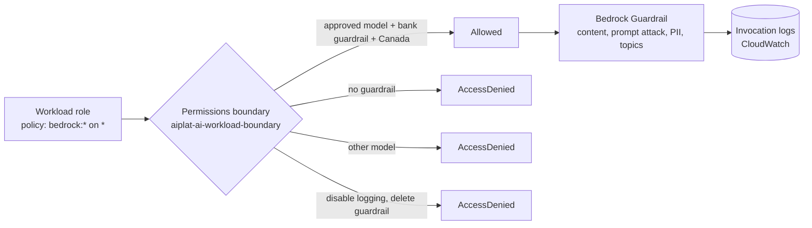

# Week 3: Guardrails as code

**Goal:** make the rules impossible to skip. Every model call must use the bank's guardrail, the approved model and Canadian Regions, and nobody can quietly turn off the audit log. Then prove it with a role that's been given far too much access.



## Deploy (2 minutes)

```bash
make week3
```

| Piece | What it does |
| --- | --- |
| **Bedrock Guardrail** `aiplat-bank-assistant` | Blocks hate, insults, sexual, violence, misconduct; blocks prompt attacks on input; masks card numbers and Canadian SINs; refuses investment advice |
| **Model invocation logging** | Every prompt and response in `/aiplat/bedrock-invocations` (30 days). Your audit trail |
| **Permissions boundary** | The maximum any AI workload role can ever do, whatever its own policy says |
| **`aiplat-prober-guarded`** | A Lambda whose role allows `bedrock:*` on everything, held back only by the boundary |

## What the boundary enforces

From [main.tf](../../infra/week03-guardrails/main.tf):

| Statement | Effect |
| --- | --- |
| `DenyUnapprovedModels` | Only the `ca.` Nova Lite profile, its models, and your own application inference profiles |
| `DenyCallsWithoutTheBankGuardrail` | `bedrock:GuardrailIdentifier` must be this guardrail's ARN (any version) |
| `DenyOutsideCanada` | `aws:RequestedRegion` must be ca-central-1 or ca-west-1 |
| `ProtectTheControls` | No deleting or changing invocation logging, no deleting or editing the guardrail |

## Prove it

```bash
make week3-test
```

Expected:

```
PASS  approved model + bank guardrail: allowed
PASS  approved model, NO guardrail: denied
PASS  unapproved model (ca.anthropic.claude-haiku-5-5) with guardrail: denied
Guardrail in action (prompt attack + card number):
  stopReason: guardrail_intervened
  answer: Sorry, I can't help with that request. Please contact Maple Leaf Bank support.
3 passed, 0 failed
```

Then open CloudWatch Logs, `/aiplat/bedrock-invocations`, and find those calls. Notice the guardrail result is logged with each one.

## Why a boundary and not an SCP?

Service Control Policies need AWS Organizations, and they never apply to the management account, so most learners can't test them in a personal account. The boundary gives the same "maximum allowed" behaviour for the roles you attach it to. The SCP version, and when to use each, is in [governance/](../../governance/README.md). In a bank you'd use both.

## The rollout process interviewers ask about

1. Ship the guardrail and logging first, with no enforcement. Watch the logs for a week
2. Attach the boundary to new roles only. Publish the rule: "AI roles must use `aiplat-ai-workload-boundary`"
3. Add an IAM policy that refuses `iam:CreateRole` without that boundary, so nobody can skip it
4. Move to an SCP at the OU level once every team is compliant
5. Every exception has an owner, a reason and an expiry date

## Check your work

- [ ] `make week3-test` shows 3 passed and a guardrail intervention
- [ ] You found the calls in the invocation logs
- [ ] You can explain why `bedrock:*` on `*` is safe here (and why you'd still never write it in production)

## Cost

Guardrails are billed per 1,000 text units (about USD 0.15 for content filters and denied topics, 0.10 for PII, in ca-central-1, October 2026). This lab uses a handful. Invocation logs cost CloudWatch ingestion and storage.

## Resume bullet

> Enforced Bedrock Guardrails, approved models and Canada-only processing with an IAM permissions boundary and SCP design, protected invocation logging from tampering, and verified the controls with an intentionally over-permissioned role.

## Go deeper

- [Enforce a guardrail with IAM (bedrock:GuardrailIdentifier)](https://docs.aws.amazon.com/bedrock/latest/userguide/guardrails-permissions-id.html)
- [Permissions boundaries for IAM entities](https://docs.aws.amazon.com/IAM/latest/UserGuide/access_policies_boundaries.html)
- [Monitor model invocation using CloudWatch Logs](https://docs.aws.amazon.com/bedrock/latest/userguide/model-invocation-logging.html)
