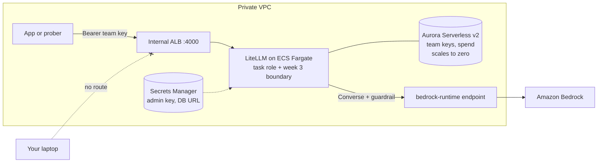

# Week 4: The AI gateway

**Goal:** one front door between every app and every model. Apps get a team key with a budget. Only the gateway's IAM role can call Bedrock, always with the bank guardrail. Nothing outside the VPC can reach it.



## Why LiteLLM and not API Gateway?

| Option | Token budgets per team? | Notes |
| --- | --- | --- |
| Amazon API Gateway usage plans | No, **requests** only | Can't tell a 10-token call from a 10,000-token one |
| Amazon Bedrock AgentCore Gateway | Governs agent **tools** (MCP) | A different job: which tools an agent may call |
| LiteLLM on ECS (AWS Guidance) | Yes: keys, `tpm_limit`, `rpm_limit`, budgets, spend tracking | What AWS's [multi-provider gateway guidance](https://aws-solutions-library-samples.github.io/ai-ml/guidance-for-multi-provider-generative-ai-gateway-on-aws.html) deploys |

Being able to explain this table is worth more in an interview than the Terraform.

## Deploy (about 20 minutes)

The gateway image has to be in your own ECR, because the VPC can't reach ghcr.io. So it's three steps:

```bash
make week4           # 1st run: creates ECR, Aurora, ALB, ECS. The service can't start yet: no image
make week4-images    # builds infra/week04-ai-gateway/gateway/ (LiteLLM + config) and pushes it
make week4           # 2nd run: ECS pulls the image and starts the gateway
```

On first start LiteLLM creates its tables in Aurora. Give it 2 to 3 minutes. Watch the logs:

```bash
aws logs tail /aiplat/ai-gateway --follow
```

## What the gateway does on every request

| Step | Where | What the caller sees when it trips |
| --- | --- | --- |
| Valid team key? | LiteLLM | 401 |
| Is this model allowed for this key? | LiteLLM (`models` on the key) | 403 |
| Over requests or tokens per minute for this key? | LiteLLM (`rpm_limit`, `tpm_limit`) | 429 |
| Add the bank guardrail to the Bedrock call | [gateway/config.yaml](../../infra/week04-ai-gateway/gateway/config.yaml) | Blocked prompts get the guardrail message |
| Call Bedrock as the gateway role | Task role, bounded by week 3 | Only the approved model, only with the guardrail |
| Record tokens and spend per key | Aurora | Used in week 7 |

## Test it

```bash
make week4-test
```

Expected:

```
PASS  gateway is healthy
PASS  a made-up key is refused (401)
PASS  team key works (200)
      answer: An AI gateway sits between apps and models and controls access...
PASS  team key can't use other models (403)
PASS  3rd call in a minute is throttled (429)
5 passed, 0 failed
```

The test creates a demo key with a 2-requests-per-minute limit, through the gateway's admin API. The admin key lives in Secrets Manager; only you (and ECS) can read it.

## Design choices to defend in an interview

- **Internal ALB on HTTP inside the VPC.** Fine for a lab. Production uses HTTPS with an internal certificate (ACM Private CA or your company PKI), and often a VPC Lattice service or PrivateLink so other accounts can reach the gateway.
- **Aurora Serverless v2 scaling to zero.** The keys database pauses after 10 idle minutes and wakes on the next request (the first call after a pause is slow). Production keeps a minimum capacity and adds Redis for rate-limit counters across gateway tasks.
- **One gateway task.** Production runs at least two, in two AZs, with autoscaling.
- **The guardrail lives in the gateway config, and the IAM boundary enforces it anyway.** Defence in depth: a config mistake can't remove the guardrail.

## Cost

| Item | About (USD, ca-central-1, check the pricing pages) |
| --- | --- |
| Fargate task (1 vCPU, 2 GB) | Roughly 1.30 a day while running |
| Internal ALB | Roughly 0.60 a day plus usage |
| 4 interface endpoints, 1 AZ | About 1 a day |
| Aurora Serverless v2 | Near zero while paused, plus storage |
| ECR | Cents for the images |

`make pause` scales the gateway and app to zero tasks between sessions.

## Resume bullet

> Built a multi-tenant AI gateway for Amazon Bedrock following AWS's reference guidance: LiteLLM on ECS Fargate behind an internal ALB, per-team keys with token and request limits, centrally enforced Bedrock Guardrails, and a scale-to-zero Aurora database, all in Terraform.

## Go deeper

- [LiteLLM: Bedrock provider](https://docs.litellm.ai/docs/providers/bedrock) and [virtual keys](https://docs.litellm.ai/docs/proxy/virtual_keys)
- [Govern AI agent tool access with Bedrock AgentCore Gateway](https://aws.amazon.com/blogs/machine-learning/govern-ai-agent-tool-access-with-amazon-bedrock-agentcore-gateway/)
