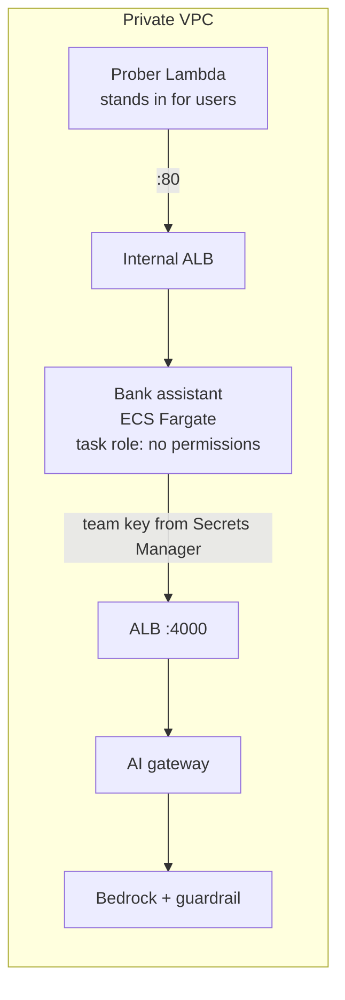

# Week 5: Run the bank assistant privately

**Goal:** host a real AI workload on your platform. The Maple Leaf Bank assistant (a RAG chatbot plus an agent that can move money) runs on ECS Fargate in the private subnets. It can only reach a model through the gateway, and its IAM role has **no Bedrock permissions at all**.



## Deploy (10 minutes)

```bash
make week5
```

It runs four steps:

1. Builds the app image from [app/Dockerfile](../../app/Dockerfile) and pushes it to ECR
2. Creates the ECS service with 0 tasks, plus an empty secret for the app's gateway key
3. [week5-key.sh](../../scripts/week5-key.sh) creates a team key for the app on the gateway (60 requests and 20,000 tokens per minute), and stores it in the secret
4. Scales the app to 1 task. ECS injects the key as `OPENAI_API_KEY`

## Test it

```bash
make week5-test
```

Expected:

```
== Health ==
{"status": 200, "body": {"status": "ok", "chunks": 8, "mode": "llm"}}
== Ask: app -> gateway -> Bedrock (with guardrail) ==
Answer: An international wire transfer costs $30 per transfer. (wording varies)
Mode: llm | latency ms: 1300
== Agent: money moves only with confirmation ==
Answer: (wording varies)
Tool calls: [{'name': 'transfer_funds', 'arguments': {...}, 'result': {'status': 'needs_confirmation'}}]
```

## Count the credentials

| Hop | How it authenticates | Secret stored? |
| --- | --- | --- |
| ECS pulls images | Execution role | No |
| App calls the gateway | Team key | Yes, one, in Secrets Manager |
| Gateway calls Bedrock | Gateway task role | No |
| Prober calls the app | Inside the VPC, no auth on the lab ALB | No |

One secret, and it's a gateway key you can revoke in seconds without touching Bedrock.

## Break it on purpose

1. Revoke the app's key on the gateway (LiteLLM's `/key/delete` with the admin key, sent through the prober), then run `make week5-test`. The app fails with 401 from the gateway. That's how you cut off one misbehaving app without affecting the others.
2. Run `./scripts/week5-key.sh` and force a new deployment (`aws ecs update-service --cluster aiplat-cluster --service bank-assistant --force-new-deployment`) to recover.

## Check your work

- [ ] `make week5-test` answers with `"mode": "llm"`
- [ ] The transfer needs confirmation: the platform enforces it in code, not in the prompt
- [ ] You can show that the app's task role has no policies attached

## Cost

One small Fargate task (0.25 vCPU, 0.5 GB), roughly USD 0.35 a day while running. `make pause` stops it.

## Resume bullet

> Deployed a containerized RAG and agent application on ECS Fargate in an egress-free VPC, with zero AWS permissions on the app role and model access only through a central AI gateway using a revocable per-team key.

## Go deeper

- [Pass Secrets Manager secrets to ECS tasks](https://docs.aws.amazon.com/AmazonECS/latest/developerguide/secrets-envvar-secrets-manager.html)
- [Amazon ECS task IAM roles](https://docs.aws.amazon.com/AmazonECS/latest/developerguide/task-iam-roles.html)
