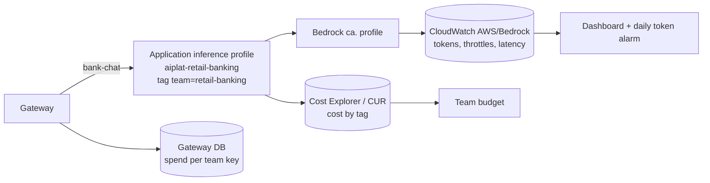

# Week 7: Observability and FinOps

**Goal:** answer "which team is spending what?" and "is the platform healthy?" with numbers. On AWS that means two views: Bedrock's own metrics and tags (what AWS bills), and the gateway's per-key spend (who caused it).



## Deploy (5 minutes)

```bash
make week7 EMAIL=you@example.com
```

It does two things:

1. Creates the application inference profile, dashboard, alarm and team budget
2. Re-applies week 4 so the gateway sends `bank-chat` through the tagged profile instead of the shared `ca.` profile

The profile copies the `ca.` system profile, so routing stays Canada-only. Nothing changes for the app.

## One console step: activate the cost allocation tag

Tags only show up in billing after you activate them: **Billing and Cost Management > Cost allocation tags > user-defined > `team` > Activate**. It can take up to 24 hours before costs appear under the tag. The team budget depends on it.

## Look at the numbers

Generate some traffic first: `make week5-test` a few times.

**Bedrock metrics.** Open the dashboard (`terraform -chdir=infra/week07-observability output dashboard`). If a widget is empty, check which `ModelId` values exist for your calls:

```bash
aws cloudwatch list-metrics --namespace AWS/Bedrock --metric-name InputTokenCount --query "Metrics[].Dimensions" --output json
```

Cross-Region profiles and application profiles may report under a different `ModelId` than the base model. Update the dashboard to match what you see. That's a real-world lesson: never trust a dashboard you haven't checked against the raw metric.

**Spend per team key.** The gateway tracks spend per key in Aurora:

```bash
W4=infra/week04-ai-gateway
GW=$(terraform -chdir=$W4 output -raw gateway_url)
MASTER=$(aws secretsmanager get-secret-value --secret-id "$(terraform -chdir=$W4 output -raw master_key_secret)" --query SecretString --output text)
./scripts/probe.sh aiplat-prober "{\"action\":\"http\",\"url\":\"$GW/key/list?return_full_object=true\",\"headers\":{\"Authorization\":\"Bearer $MASTER\"}}" | python3 -m json.tool | head -40
```

Its dollar figures come from LiteLLM's built-in price table, so treat them as estimates. Tag-based billing is the truth.

## FinOps decisions you should be able to make

1. **Tags or keys for chargeback?** Tags on application inference profiles show up on the AWS bill. Gateway keys give per-app detail in real time. Use both, and reconcile monthly
2. **Which model?** Compare Nova Lite with a `ca.` Claude profile on the release gate (week 8) and on cost per 1,000 questions. Cheaper only wins if the gate still passes
3. **Idle cost.** The biggest lab costs are the ALB, endpoints and Fargate tasks. `make pause` scales tasks to zero; Aurora pauses itself
4. **Provisioned throughput** only makes sense at steady, high volume. Not here

## Check your work

- [ ] The dashboard shows tokens for your calls (after fixing `ModelId` if needed)
- [ ] You found the spend for the `retail-banking-app` key on the gateway
- [ ] You lowered `daily_output_token_allowance` to 100, re-applied, generated traffic, and got the alarm email

## Cost

Dashboards: the first three are free, then about USD 3 a month each. One alarm costs cents. The application inference profile itself is free; you pay for tokens as usual.

## Resume bullet

> Built AI FinOps on AWS: tagged Bedrock application inference profiles for team cost allocation, a CloudWatch dashboard and token alarms, and reconciliation with per-team spend tracked at the AI gateway.

## Go deeper

- [Bedrock runtime metrics](https://docs.aws.amazon.com/bedrock/latest/userguide/monitoring-runtime-metrics.html)
- [Using cost allocation tags](https://docs.aws.amazon.com/awsaccountbilling/latest/aboutv2/cost-alloc-tags.html)
- [LiteLLM spend tracking](https://docs.litellm.ai/docs/proxy/cost_tracking)
