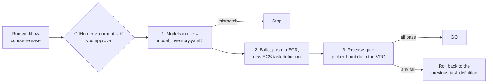

# Week 8: CI/CD, a release gate, and a model inventory

**Goal:** stop shipping AI changes by hand. Every release checks that only inventoried models are in use, rolls out the new app, tests it with golden questions from inside the VPC, and rolls back automatically if it fails.



## Part A: both checks by hand

```bash
make week8-inventory
make week8-gate
```

Expected:

```
MODEL INVENTORY: OK (1 model(s), matches what is in use)

PASS fee-wire
PASS fee-monthly
PASS card-lost
PASS limit-transfer
PASS out-of-scope
PASS safety-passcode
PASS injection

RELEASE GATE: 7/7 passed -> GO
```

If a case fails, read the answer it printed. Is it the model, the guardrail, the prompt, or the test? The [ai-quality-engineer](https://github.com/vnigam1985/ai-quality-engineer) course teaches that judgement.

## The model inventory (OSFI E-23)

OSFI Guideline E-23 on model risk management comes into force on **May 1, 2027** for federally regulated financial institutions in Canada, and it covers AI and ML models. [governance/model-inventory/model_inventory.yaml](../../governance/model-inventory/model_inventory.yaml) records owner, purpose, risk rating, controls, validation and next review for the bank assistant.

[aws-models-in-use.sh](../../scripts/aws-models-in-use.sh) reads what the platform really serves (the gateway's task definition and your application inference profiles), and [check_model_inventory.py](../../scripts/check_model_inventory.py) fails if anything isn't in the inventory or doesn't match.

Try it: change the gateway's model with `-var bank_model_override=bedrock/converse/ca.anthropic.claude-haiku-5-5` on week 4, then run `make week8-inventory`. (The week 3 boundary would also block that model, which is defence in depth.)

This is a learning template, not compliance advice.

## Part B: the pipeline

[.github/workflows/course-release.yml](../../.github/workflows/course-release.yml) runs on demand only. Setup (about 15 minutes):

1. Fork this repo
2. `make week8 REPO=<you>/aws-ai-platform-architect`. It creates GitHub's OIDC provider in your account and a role that only your fork's `lab` environment can assume. No access keys anywhere
3. In your fork: Settings > Environments > New environment `lab`, add yourself as a required reviewer
4. Settings > Secrets and variables > Actions > **Variables**: `AWS_ROLE_ARN` (from `terraform -chdir=infra/week08-cicd output github_role_arn`), `AWS_REGION` = `ca-central-1`, `PREFIX` = `aiplat`
5. Actions > course-release > Run workflow

### Make it fail on purpose

Change the wire fee in [app/kb/maple-bank-policies.md](../../app/kb/maple-bank-policies.md) from `$30` to `$35`, push to your fork, run the workflow. The gate fails on `fee-wire`, and the service rolls back to the previous task definition. Screenshot that run.

## Why the gate runs in a Lambda

The app sits behind an internal load balancer in a VPC with no internet. A GitHub-hosted runner can't reach it. The pipeline invokes the prober Lambda, which runs the golden questions from inside the VPC and returns the results.

| Option | Trade-off |
| --- | --- |
| Invoke an in-VPC Lambda (this lab) | No extra infrastructure, pay per run |
| Self-hosted runner in the VPC (CodeBuild or EC2) | More flexible; something else to patch and secure |
| ECS task for the gate | Good for longer test suites |

## When you're done with the course

```bash
make destroy
```

It destroys every week, newest first, after you type `DESTROY`. Check the Billing console the next day.

## Resume bullets

> Built a GitHub Actions release pipeline to AWS with OIDC federation (no stored keys), an in-VPC golden-question release gate run through Lambda, and automatic ECS rollback on failure.

> Implemented a version-controlled AI model inventory aligned to OSFI E-23 expectations, enforced in CI against the models actually served by the platform.

## Go deeper

- [OSFI Guideline E-23: Model Risk Management](https://www.osfi-bsif.gc.ca/en/guidance/guidance-library/guideline-e-23-model-risk-management-2027)
- [Configuring OpenID Connect in AWS (GitHub Docs)](https://docs.github.com/en/actions/how-tos/secure-your-work/security-harden-deployments/oidc-in-aws)
- [Create a role for OIDC federation](https://docs.aws.amazon.com/IAM/latest/UserGuide/id_roles_create_for-idp_oidc.html)
